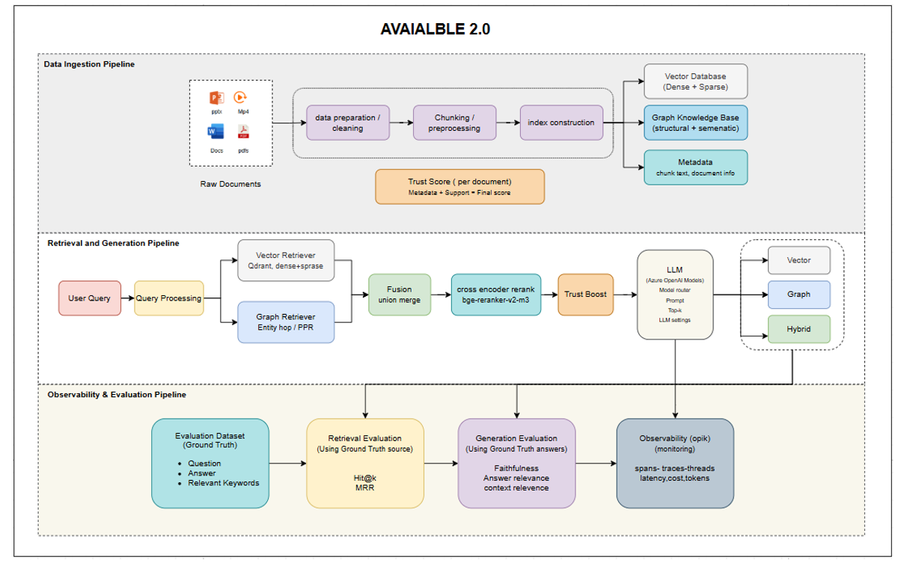

# System Architecture

AVAILABLE separates preparing knowledge from answering questions. This makes
data refreshes an operational workflow rather than a task performed for every
user request.

*Conceptual overview, including optional stages. [Open full size](../assets/figures/architecture/available-2-overview.png).*

## Offline Knowledge Preparation

SharePoint ingestion organizes source content, and sync maintains a local raw
mirror. Preprocessing turns supported documents into searchable text, summaries,
and media references. Indexing produces two connected retrieval representations:

- **Qdrant** stores dense and sparse chunk embeddings plus a separate entity index.
- **The knowledge graph** stores the corpus hierarchy, passages, entities, and relations.

A local parent-document store reconnects retrieved child chunks with larger
context passages. Extracted images and the handbook remain filesystem artifacts.
Trust scoring uses metadata and graph signals for supported corpus workflows.

## Question Answering

The UI selects vector-only retrieval or vector plus graph retrieval. Retrieved
candidates are merged and may be cross-encoder reranked, depending on
configuration. Trust can adjust ranking before the final passages are supplied
to Azure OpenAI. The generated answer is displayed with source information.

!!! note "Capabilities versus active defaults"
    The architecture diagrams include the optional reranker. The checked source
    configuration currently disables it. The LLM judge is also opt-in.
    See [configuration](../reference/configuration.md) for active defaults.

## Components and Boundaries

| Component | Responsibility | Must stay consistent with |
| --- | --- | --- |
| Streamlit | User interaction, answers, and evidence inspection. | Selected source and prepared knowledge base. |
| Pipeline | Data synchronization, preprocessing, indexing, and trust orchestration. | Corpus layout, credentials, and artifact paths. |
| Qdrant | Chunk retrieval and entity matching. | Embedding model, collections, and chunk identifiers. |
| Graph and document store | Relationships, provenance, and parent context. | The same corpus build as Qdrant. |
| Azure model services | Summarization, semantic extraction, agents, and generation. | Approved endpoints, deployments, and identity roles. |
| Opik | Request traces and optional quality feedback. | Approved telemetry destination and retention policy. |

Do not treat filesystem artifacts and Qdrant as interchangeable backups. A
working restore needs a compatible set of both.

## From AVAILABLE 1.0 to 2.0

The baseline used FAISS semantic retrieval and optional manual trust ratings.
AVAILABLE 2.0 adds staged data processing, Qdrant dense/sparse retrieval,
knowledge-graph retrieval, hybrid candidate fusion, automated trust workflows,
observability, and evaluation tooling. Older implementation notes may therefore
refer to FAISS or layouts that are no longer the main workflow.

Continue with [hybrid retrieval](retrieval.md), the
[knowledge graph](knowledge-graph.md), or [trust scoring](trust.md).