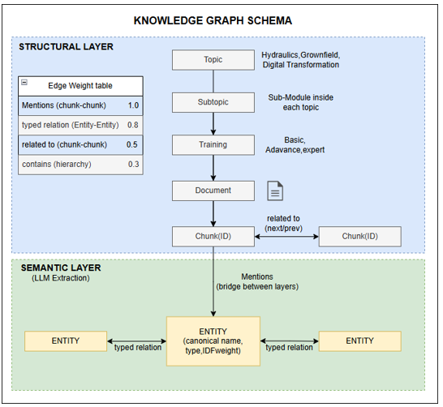

# Knowledge Graph

The graph connects training structure with concepts extracted from passages. It
adds a relationship-based retrieval path alongside semantic similarity.

*Conceptual schema. The implemented hierarchy includes a Level node between
Subtopic and Training; the figure abbreviates that part. Its mentions-edge table
label should be read as Chunk-to-Entity, not Chunk-to-Chunk.
[Open full size](../assets/figures/graph/graph-schema.png).*

## Structural Layer

The corpus hierarchy is represented as Topic, Subtopic, Level, Training,
Document, and Chunk nodes where applicable. `contains` and `part_of` connect the
hierarchy; `related_to` represents relationships such as passage sequence.
Structural construction uses ingestion metadata rather than model inference.

## Semantic Layer

Semantic extraction identifies entities and typed relations from groups of
passages. Merging consolidates repeated entity mentions, and integration links
chunks to entities through `mentions` edges. Topic-level node and edge artifacts
are stored on disk. A separate Qdrant entity collection makes the entities
searchable for query seeding.

Entity and relation extraction is model-generated and can be incomplete or
incorrect. A graph connection represents an extracted relationship, not an
independently verified fact.

## Retrieval Engines

| Engine | Approach | Main tradeoff |
| --- | --- | --- |
| Entity hop | Follow matched entities to passages that mention them; optional further hops are configurable. | Direct and interpretable, but coverage depends on seed quality and hop controls. |
| Personalized PageRank | Spread query-seeded weight through semantic and structural connections, then rank passages. | Broader relationship coverage, with additional sensitivity to graph quality and weighting. |

The current PPR configuration filters generic entities, merges concept fragments,
and restricts traversal to dominant matched topics. Specificity weighting reduces
the influence of common entities but does not eliminate poor matches.

## Maintenance Contract

Keep graph chunks aligned with the vector corpus and parent-document store.
Build structural outputs before semantic integration, and refresh entity indexes
when semantic content changes. Recompute graph-dependent trust after rebuilding.
Use the [pipeline guide](../operations/pipeline.md) for stage controls rather than
editing generated node or edge files manually.