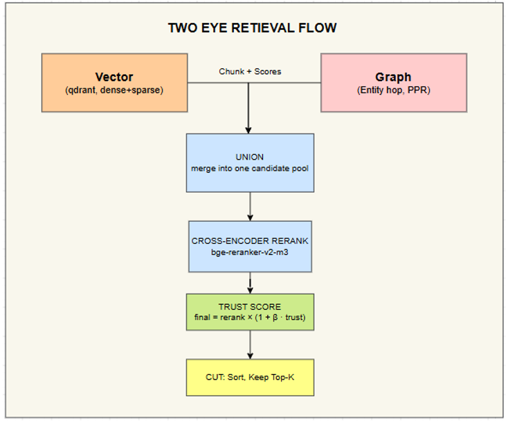

# Hybrid Retrieval

Hybrid retrieval combines text similarity with graph relationships. Both paths
operate on passages derived from the same corpus and use shared identifiers to
avoid treating the same evidence as two different passages.

*The supported hybrid flow. Cross-encoder reranking is optional and currently
disabled. [Open full size](../assets/figures/architecture/hybrid-retrieval.png).*

## Vector Retrieval

BGE-M3 generates dense and sparse representations of text. Qdrant uses them to
find passages related to a question. The parent-document pattern searches small
child chunks and returns larger passages as context, preserving more information
than an isolated text fragment.

Dense/sparse search within Qdrant is distinct from the system's vector-plus-graph
hybrid retrieval. "Hybrid" can refer to either combination; these guides use
"hybrid retrieval" for the two system retrieval paths unless stated otherwise.

## Graph Retrieval

The question is matched to indexed entities. The configured graph engine uses
those matches to find connected passages. Personalized PageRank is the current
default; entity-hop retrieval is an alternative. Dense passage seeds can also
contribute to PPR, so the two paths are complementary rather than completely
isolated computations.

## Candidate Fusion and Ordering

Union fusion merges and deduplicates the candidates from both paths. An optional
cross-encoder reads a question and passage together to refine their order.
Reciprocal Rank Fusion is retained as an alternative for experiments.

When enabled and a trust table is available, document trust adjusts candidate
scores. The final top passages are sent to the language model; recommended
documents are derived from those retained passages. Retrieval relevance, source
trust, and generated-answer correctness are different properties.

## Choosing and Evaluating a Mode

Q&A offers Thinking for vector-plus-graph and Fast for vector-only retrieval.
Developer experiments can isolate vector or graph legs through source settings.
Compare modes using a fixed dataset and record the full configuration. Do not
assume a larger candidate pool or a more connected graph always improves quality.

See [configuration](../reference/configuration.md) for current limits. Record
retrieval and generation metrics separately when evaluating a change.