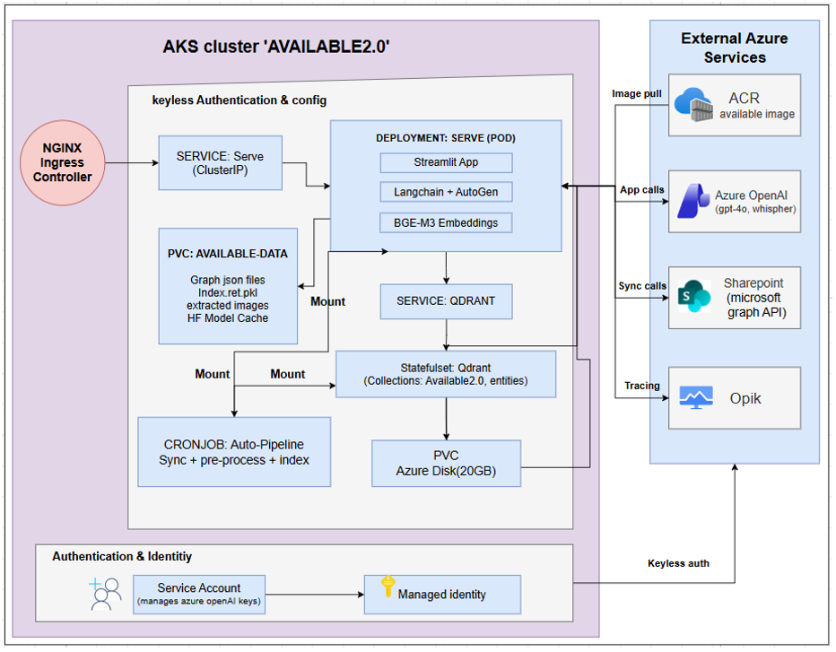

# Azure AKS Deployment

This guide describes deployment requirements and checks. It is not a claim that
the current Azure environment is healthy or that older permission blockers are
still open. Confirm live status with the environment owner before acting.



*Deployment topology. The service account participates in federated Workload
Identity; it does not manage Azure OpenAI API keys. Opik authentication is
deployment-specific, not guaranteed by the identity arrow in this figure.
[Open full size](../assets/figures/deployment/azure-aks.png).*

## Resources and Storage

| Resource | Responsibility |
| --- | --- |
| AKS namespace | Isolate the workload; existing manifests use `available-2`. |
| ACR | Store the approved application image. |
| Qdrant StatefulSet and persistent disk | Store chunk and entity collections. |
| `available-data` shared PVC | Store raw mirror, graph, parent-document store, extracted media, and optional model cache. |
| `serve` Deployment and Service | Run Streamlit and expose it inside the cluster. |
| Ingress | Route the external application address to the Service. |
| Pipeline CronJob | Refresh knowledge using the configured SharePoint workflow. |

Review manifests under `deployment/kubernetes` against the intended environment.
The existing files contain concrete deployment values, not universally safe
templates. Use an approved immutable image tag or digest for repeatability.

## Authentication Requirements

| Identity or credential | Access required |
| --- | --- |
| AKS kubelet identity | Registry image-pull permission. Use `AcrPull` for the applicable registry RBAC mode; ABAC-enabled registries require the corresponding repository role and assignment approach. |
| App workload identity | Permission to invoke the configured Azure model deployments, typically `Cognitive Services OpenAI User` for the classic OpenAI path. |
| SharePoint app registration | Approved Graph permissions to the intended sites/folders. |

Do not confuse the kubelet identity with the app identity. Workload Identity needs
AKS OIDC/federation, the pod label, service account annotation, and a federated
subject whose namespace and service account match exactly. Confirm the selected
credential path in the running image. An administrator with role-assignment
permissions may be needed; ordinary contributor access is not sufficient for
every IAM operation.

## Deployment Order

1. Confirm subscription, resource group, cluster, namespace, registry, and owners.
2. Review image, identity, network, endpoint, storage, and secret configuration.
3. Provision namespace, identity binding, configuration, approved secrets, and PVCs.
4. Start Qdrant and verify its persistent storage and service reachability.
5. Populate a coordinated artifact set and matching Qdrant collections, either by
   an approved pipeline run or by restoring a tested backup.
6. Deploy `serve` and validate readiness, logs, citations, and model access.
7. Enable scheduled refresh only after reviewing its rebuild behavior and cost.

The full pipeline also needs the GROWNFIELD source metadata settings used by trust
collection, not just the AVAILABLE sync folder. A first sync that succeeds does
not establish that trust collection will succeed.

!!! warning "Scheduling can replace the active index"
    The automatic pipeline performs a full index refresh when sync reports an
    addition or deletion. Do not enable it against a reused/restored corpus
    without backups, a maintenance plan, and a tested recovery path. Do not run
    separate sync-only and full-pipeline schedules concurrently: a sync-only job
    can consume changes before the full pipeline sees them.

## Read-Only Validation Commands

Run only in an authorized environment, with the intended Kubernetes context:

```powershell
kubectl get pods -n available-2
kubectl get pvc -n available-2
kubectl get cronjobs -n available-2
kubectl logs -n available-2 deploy/serve --tail=80
kubectl get ingress -n available-2
```

Where a corporate proxy prevents direct Kubernetes API access, an approved ARM
command invocation is an alternative:

```powershell
$resourceGroup = "<resource-group>"
$cluster = "<aks-cluster>"
az aks command invoke -g $resourceGroup -n $cluster --command "kubectl get pods -n available-2"
```

This still accesses Azure and requires permission. It is a documented operator
action, not something needed or executed for local documentation preview.

## Diagnose the Boundary That Failed

| Symptom | First checks |
| --- | --- |
| Image pull unauthorized | Registry policy, image name/tag, and kubelet permissions. |
| App startup fails | Parent-document store mount and matching Qdrant collection. |
| Model call unauthorized | Pod federation, selected credential, endpoint, model deployment, and model role. |
| Slow first start | Embedding downloads, model cache, network, CPU, and memory. |
| UI unavailable | Readiness, Service target port, ingress routing, WebSockets, and DNS/TLS. |

The current serve manifest uses internal port `8501`; do not infer it from the
native example's `8502` port. Streamlit keeps session state in process, so scaling
replicas needs deliberate session routing and resource planning.

## Production Readiness

Before exposing the app, review authentication/authorization, TLS, allowed hosts,
network policy, secret storage/rotation, monitoring, retention, and recovery.
The checked ingress is hostless and the serve manifest disables Streamlit CORS
and XSRF protections. Those settings require a security review; a working public
IP is not evidence of production readiness. Do not expose Qdrant directly.

## Backup, Restore, and Rollback

Pause writers before capturing a backup. Preserve both Qdrant collection
snapshots and the matching filesystem artifacts, plus source selection, model
versions, image digest, and manifest version. Snapshot sizes and point counts
from an old deployment are not current acceptance criteria.

Test restoration in isolation, verify identifiers and citations, then switch the
application during a controlled maintenance window. Rolling back only the app
image does not roll back a rebuilt collection or graph. Restart processes after
artifact replacement to clear cached state. Storage copies and snapshots may
contain restricted training content and must follow the same access policy.