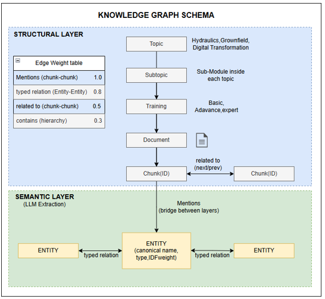

# Graph Retrieval Design

Graph retrieval adds a query-seeded passage ranking over the same corpus indexed
in Qdrant. Its purpose is to recover connected evidence, not to execute a formal
proof or guarantee that extracted relationships are correct. Start with the
[conceptual schema](../architecture/knowledge-graph.md) for a shorter overview.

*The implemented hierarchy also includes Level. Mentions connect chunks to
entities; one table label in the supplied figure abbreviates this incorrectly.
[Open full size](../assets/figures/graph/graph-schema.png).*

## From Corpus to Retrieval Artifacts

| Preparation stage | Result | Design purpose |
| --- | --- | --- |
| Structural construction | Topic, optional Subtopic, Level, Training, Document, and Chunk nodes with hierarchy/explicit links. | Preserve source organization and provenance without an LLM. |
| Semantic extraction | Entity and typed-relation candidates with evidence and confidence. | Represent concepts that connect passages. |
| Semantic merge | Consolidated entities/relations, evidence references, occurrence statistics, and entity specificity. | Reduce repeated extraction and expose common versus specific concepts. |
| Graph integration | Topic-level `nodes.jsonl` and `edges.jsonl`, including chunk-to-entity mentions. | Provide a shared retrieval representation. |
| Entity indexing | A separate dense/sparse Qdrant entity collection. | Match a natural-language question to graph entry points. |

Semantic merging groups normalized labels with entity types. Query-time concept
merging is a separate operation: it can share seed weight across same-label
entity fragments without rewriting their stored nodes. Do not confuse changing
query seed policy with rebuilding the graph.

The structural graph and vectors reuse ingestion chunk identifiers. Entity
indexing embeds a short label/type representation, not every full source passage.
It stores one point per topic/entity pair with deterministic UUID mapping and
payload fields for label, type, topic, IDF, and distinct-chunk frequency. The
same concept in two topics retains separate records and topic-specific evidence.
Rebuilding this index recreates its target collection; source isolation matters.

## Construction Decisions and Evidence Boundaries

### Deterministic Structure

Hierarchy is derived from ingestion metadata and corpus paths. Explicit chunk,
document, and training identifiers are reused where available; fallback
hierarchy identifiers are normalized from names/paths. Subtopic chains are part
of Level identity, so two branches can each have an Advanced level without
sharing that node. Each hierarchy connection is written as both `contains`
and inverse `part_of`.

The structural accumulator deduplicates nodes by identifier and edges by their
stored edge record. Changing source path layout, metadata identity, or explicit
link policy can therefore alter the graph even without semantic extraction.
Retain ingestion, graph, and vector artifacts from the same build.

### Extraction Input

Semantic preparation excludes empty/too-short content, meta summaries, folder
records, and records without an owning document field. Eligible content is
prepared in overlapping batches. The extraction prompt includes topic, training,
document, and batch identity, plus chunk IDs and at most 1200 characters of each
passage. Later content in a long passage is not visible to that extraction call.

The configured language model returns entities and typed relations with
confidence and evidence chunk IDs. Its prompt asks for explicit support and
allows empty arrays when uncertain. These are instructions to a model, not a
formal validation that every returned label, relation, or evidence reference is
correct. Retain extraction failures and coverage statistics in build reporting.

### Canonicalization and Integration

Stored entities are grouped by normalized label **and** entity type. Their
canonical display label is the most frequent spelling; confidence is averaged,
and evidence chunk IDs/source batch IDs are deduplicated. IDs follow the
type-qualified form `entity::<type slug>::<label slug>`. Slug normalization
replaces non-alphanumeric sequences, so changes to normalization or identifier
collision handling are schema changes, not cosmetic text cleanup.

Each evidence chunk reference produces a Chunk-to-Entity `mentions` edge, with
extraction provenance retained. A relation connects its source and target labels
to stored entity IDs. If a label has several typed entities, integration selects
the most frequent candidate, with deterministic tie-breaking; unresolved
endpoints are skipped. This is a disambiguation heuristic, not entity linking
against an external knowledge base.

Inspect failed batches, unresolved relations, references to absent chunk IDs,
and entities with little evidence before attributing retrieval misses to PPR.
In particular, semantic relations do not create missing source text: graph
reachability and downstream document-store hydration are separate requirements.

## Entity Matching and Specificity

Entity lookup runs hybrid dense/sparse search and a dense-only search. Dense
scores are joined onto the hybrid hit list by topic and entity identifier;
dense-only hits outside that list are not automatically added. Matching exposes
both signals rather than assuming a hybrid rank-fusion score is a cosine value.

The default query seed signal is the maximum of the available hybrid and dense
scores. This is a practical selection heuristic, not a calibrated probability.
IDF is `log(total corpus chunks / distinct evidence chunks for the entity)`,
with zero used when either count is unavailable/nonpositive. Generic terms can
match a question well yet provide weak discrimination between documents.
Missing IDF and stale entity frequencies therefore affect retrieval, not just
diagnostic reporting.

## Supported Engines

| Engine | Ranking mechanism | Additional inputs |
| --- | --- | --- |
| [PPR](ppr.md) | Query-personalized diffusion through a weighted graph. | Optional vector passage seeds. |
| [Entity hop](entity-hop.md) | Seed-to-passage mentions scoring, with bounded expansion variants. | No vector passage seeds in the standard engine path. |

`GRAPH_RETRIEVAL_MODE` selects the engine; current default is `ppr`. Both return
ranked chunk identifiers and diagnostics through the same downstream contract.
The shared interface does not mean they have identical scoring, gating, or
normalization.

## Topic Selection

Graphs are stored and searched by topic; there is no cross-topic graph traversal.
With `PPR_TOPIC_ISOLATION=True`, entity member weight is summed per topic and
topics at least `PPR_TOPIC_KEEP_RATIO` times the strongest topic are retained.
The default ratio is `0.5`. This controls foreign-topic matches but can remove
legitimate cross-topic evidence.

The topic calculation uses member-level signal times IDF, not necessarily the
merged concept group's final poured mass. If matched topics do not map to graph
folders, PPR can consider all topic folders and then skip those with no valid
seeds. Do not infer the searched topic set from a UI label alone.

## Downstream Contract

The graph result carries ordered chunk/score pairs, an abstention flag, list
weight, matched entities, concentration, fallback state, and optional diagnostics.
It can also carry a graph-internal document ranking. The main hybrid pipeline
hydrates identifiers from the document store and derives its final recommended
documents from selected passages instead of using that internal list directly.

Distinguish these outcomes when monitoring:

- **Abstained:** no usable graph seed/evidence for the engine's policy.
- **Empty but not abstained:** entities matched, but no usable passage was reached
  or landed in a graph. This is not a successful evidence contribution.
- **Exception:** malformed/missing artifacts or another retrieval failure; the
  hybrid boundary may catch it and continue with vectors.

`list_weight` affects RRF only when its graph-weight policy selects that value.
It does not weight union candidates. Graph scores are not probabilities and are
not directly comparable with Qdrant or cross-encoder scores.

## Maintenance and Extension Rules

Preserve identifiers and topic membership across entity payloads, graph nodes,
and the document store. Check semantic evidence coverage before tuning walk
parameters. For engine comparisons, hold entity selection, topic isolation,
candidate limits, and document diversity fixed. PPR passage seeding must also
be controlled: graph-only evaluation does not receive vector hits.

Graph objects are cached in process. PPR's current cache is keyed by topic and
edge weights, not graph-root path or artifact version; the entity-hop topic
indexes are also cached. Restart the process when replacing artifacts and avoid
switching same-named corpus roots inside a long-lived process without an explicit
cache policy. A future versioned graph loader should make that boundary explicit.

Construction and query behavior are owned by `dc_available/graph/construct/`
and `dc_available/graph/retrieval/`. The integration and final context contract
are described in [Hybrid Retrieval Design](hybrid-retrieval.md).