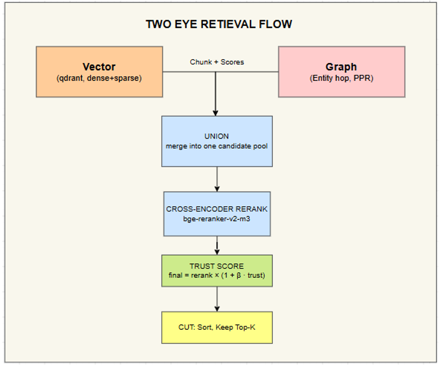

# Hybrid Retrieval Design

This guide describes how AVAILABLE combines vector and graph candidates into
answer context. It complements the [architecture overview](../architecture/retrieval.md)
with ranking contracts, failure behavior, and extension considerations. It covers
the training-corpus Q&A path, not the separate RICH workflow.



*Supported processing stages. Reranking is optional;
[open the full-size diagram](../assets/figures/architecture/hybrid-retrieval.png).*

## Processing Contract

| Step | Input | Output |
| --- | --- | --- |
| Vector search | Question and chunk collection. | Ordered documents with chunk identifiers and Qdrant scores. |
| Graph retrieval | Question, graph artifacts, entity collection, and optional vector hits. | Ranked chunk identifiers, graph scores, and diagnostics. |
| Hydration | Graph identifiers not already represented by vector results. | Documents resolved from the local document store. |
| Fusion | Ordered chunk identifiers from both paths. | Deduplicated candidates with vector/graph rank provenance. |
| Optional reranking | Question and candidate text. | Cross-encoder relevance scores for the full hydrated pool. |
| Trust and selection | Candidate scores and document trust. | Sorted top passages and source-document recommendations. |

The vector search runs before graph retrieval in the current request path.
Although the architecture has two retrieval legs, this is not concurrent
execution. PPR can consume the vector hits as passage seeds, so the graph leg
is not fully independent in the combined mode.

## Candidate Identity and Hydration

The metadata chunk identifier is the fusion key. It must mean the same passage
in Qdrant, graph artifacts, and the document store. When both legs return the
same identifier, the vector result supplies the already-loaded document and the
pool records both ranks. A graph-only identifier is looked up in the document
store. Missing entries are omitted rather than replaced with synthetic text.

Hydration failures reduce the usable pool even when graph retrieval reported
many candidates. Track returned identifiers and hydrated documents separately
when diagnosing recall. A graph rebuild without the matching document-store
update can silently remove graph-only evidence from answer context.

## Union Fusion

Union is the default strategy. It alternates candidates by rank:

```text
vector: A, B, C
graph:  C, D, A
union:  A, C, B, D
```

An identifier is emitted once at its earliest interleaved position; both original
ranks are retained. The candidate's union score is `0.0`: union preserves coverage
and provenance but does not calculate a common relevance score. The full union
is hydrated; `FUSION_CANDIDATE_K` does not truncate this strategy.

With ten candidates per leg, the union contains at most twenty distinct
identifiers before hydration. Overlap, empty legs, and unresolved documents can
make it smaller.

## Reciprocal Rank Fusion

RRF is an alternative strategy for controlled comparisons. For a candidate,
each contributing leg adds its weight divided by `K + rank`, with ranks starting
at one. A repeated identifier within one leg contributes only its first rank.
Raw vector and graph scores are not added together: their scales are unrelated.

The default RRF damping constant is `60` and vector weight is `1.0`. Graph weight
can be fixed or derived from the graph result's list weight; abstention makes it
zero. The fused list is truncated to `FUSION_CANDIDATE_K` before hydration.
Consequently, a missing document can consume a pre-hydration candidate slot.

## Cross-Encoder Reranking

When enabled, the cross-encoder reads the question together with each candidate
passage. The configured model is `BAAI/bge-reranker-v2-m3`. Scores use the model's
normalized output, but should not be interpreted as calibrated probabilities of
relevance or answer correctness.

The whole hydrated pool is scored before trust adjustment and final truncation.
This allows trust to influence which candidates cross the final context cutoff,
not only reorder an already truncated list. Model loading is lazy and cached
per process; distinguish first-use download/loading from warm inference latency.
The default runtime setting currently disables this stage.

## Trust Adjustment and the No-Reranker Case

When enabled, trust changes each score by multiplying it by
`1 + TRUST_BETA * document_trust`. Candidates are then sorted descending and
the first `FUSION_OUTPUT_K` are selected. Trust does not introduce new candidates.

!!! important "Current default: union without reranking"
    Union supplies zero scores. With `RERANKER_ENABLED=False`, the downstream
    score remains zero even when trust is enabled: multiplying zero cannot
    reorder candidates. The stable sort preserves union's interleaved order.
    Trust metadata can still be attached and displayed, but it does not affect
    selection in this configuration.

RRF without reranking differs: its nonzero rank-fusion scores can be adjusted by
trust. Do not compare these configurations as though "trust enabled" necessarily
means the same ranking effect. A future union scoring policy must explicitly
define score calibration, ties, and compatibility with trust before being added.

## Final Passages, Recommendations, and Modalities

The selected passages determine the document recommendations; there is no second
independent document-fusion stage. Documents inherit their first/highest-ranked
selected passage's score and are deduplicated by document name, up to
`FUSION_DOC_TOPN`. Provenance flags come from that selected passage, not from an
aggregation over every passage belonging to the document. Reused names across
topics can therefore collide; a future identity change needs a coordinated
document-key policy.

When all-modality expansion is requested, video passages can be replaced by
matching audio/image/video sibling documents after the ranking and recommendation
steps. `FUSION_OUTPUT_K` limits the pre-expansion list, not necessarily the final
number of context documents. Measure actual post-expansion context size and
source coverage when changing multimodal retrieval.

## Failure and Isolation Behavior

- Fast Q&A requests vector-only retrieval through a per-request leg choice.
- Thinking requests both legs. Graph-only evaluation skips vector search and
  therefore provides no vector passage seeds to PPR.
- Graph exceptions are caught at the fusion boundary; graph failure or
  abstention leaves the vector candidates available in combined mode.
- A graph-only request has no vector fallback. Graph failure can leave it empty.
- Vector search, model loading, and reranker failures are not all protected by
  the graph exception handler. Do not describe the whole pipeline as fail-open.

The trace records pool size, leg overlap, abstention, strategy, ranks, final
scores, and retained identifiers. Examine these before attributing a poor answer
to the language model.

## Current Controls

| Control | Current value | Scope |
| --- | --- | --- |
| `FUSION_LEGS` | `both` | Default legs; a request can override it. |
| `FUSION_STRATEGY` | `union` | Candidate-combination policy. |
| `FUSION_VECTOR_K` / `FUSION_GRAPH_K` | `10` / `10` | Per-leg candidate limits. |
| `FUSION_CANDIDATE_K` | `20` | RRF pre-hydration pool limit only. |
| `FUSION_OUTPUT_K` | `10` | Passage cutoff before optional modality expansion. |
| `FUSION_DOC_TOPN` | `5` | Recommended document limit. |
| `RERANKER_ENABLED` | `False` | Whether relevance scores replace fusion scores. |
| `TRUST_ENABLED` / `TRUST_BETA` | `True` / `0.5` | Multiplicative adjustment, subject to the base-score caveat. |

These are source configuration settings, not generic environment variables.

## Extending the Design

Preserve chunk identity and rank provenance across any new retriever or fusion
policy. Define what happens when a leg abstains, documents cannot be hydrated,
scores tie, or a request has only one leg. Avoid request-time mutation of global
configuration: the current UI passes leg selection per request.

Evaluate candidate recall before final ranking, post-selection source Hit@k/MRR,
answer quality, context length, stage latency, and model cost. Hold corpus,
question set, graph seeding, and output limits fixed when comparing fusion or
reranking. Graph-only versus hybrid PPR also changes seed availability, not just
the presence of a second result list.

## Implementation Ownership

The owning surfaces are `dc_available/RAG/qa_functions.py` for request sequencing,
hydration, trust application, and selection; `dc_available/RAG/fusion.py` for
union/RRF; and `dc_available/RAG/reranker.py` for model scoring. They are listed
as maintenance locations, not as a required reading order or function walkthrough.