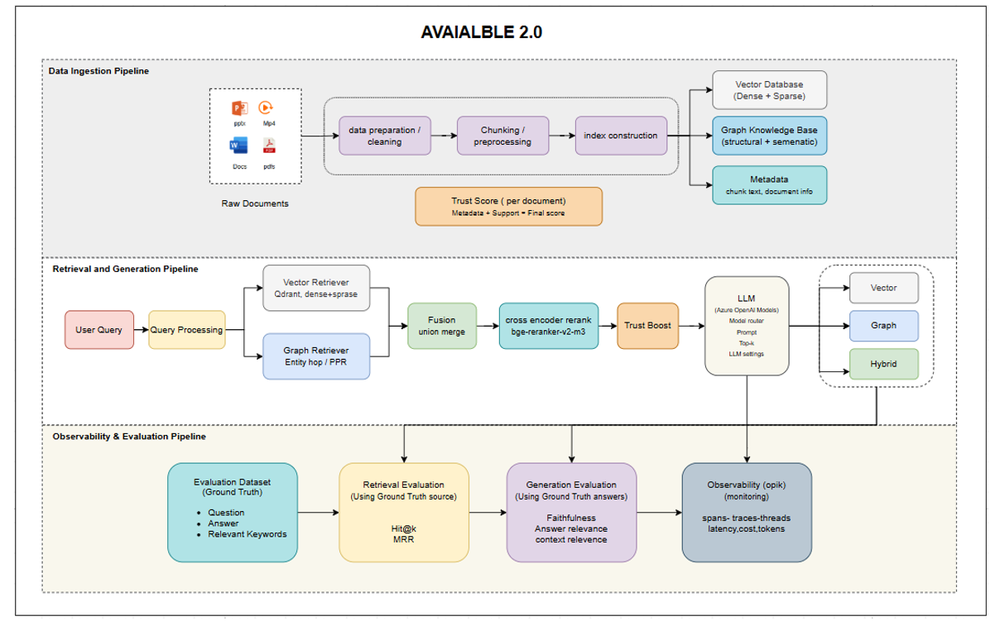

# AVAILABLE 2.0

AVAILABLE 2.0 is a retrieval-augmented learning assistant for Bosch Rexroth
training material. It combines semantic search and a knowledge graph to retrieve
supporting passages, then uses Azure OpenAI to generate answers with source
references.

*System overview. [Open the full-size diagram](assets/figures/architecture/available-2-overview.png).*

## Two Ways to Use AVAILABLE

| Experience | Purpose |
| --- | --- |
| Assistant | Discuss a learning goal and find suitable training material. |
| Q&A | Ask a specific question and inspect the supporting sources. |

## How the System Fits Together

An offline pipeline synchronizes source material, preprocesses documents, builds
vector and graph indexes, and computes document trust scores. At question time,
retrieval candidates are combined, reranked, and passed to the language model.
Opik can record traces for investigation and evaluation.

!!! warning "Answers need verification"
    Answers and trust scores are decision aids, not guarantees of correctness.
    Check the cited source and follow approved procedures for operational or
    safety-relevant work.

## Documentation Scope

| Start here | For |
| --- | --- |
| [Getting Started](getting-started/index.md) | Install, configure, and ask a first question with local material. |
| [User Guide](user-guide/index.md) | Use the Assistant, Q&A modes, and source evidence. |
| [Architecture](architecture/index.md) | Understand system boundaries, retrieval, graph, and trust. |
| [Pipeline Operations](operations/pipeline.md) | Prepare and refresh the knowledge base. |
| [Deployment](deployment/local-docker.md) | Run a local container or review AKS requirements. |
| [Developer Guide](development/index.md) | Find ownership boundaries and plan evaluated changes. |
| [Configuration](reference/configuration.md) | Check supported settings and current defaults. |
| [Troubleshooting](reference/troubleshooting.md) | Diagnose startup, retrieval, and integration problems. |

These guides cover using, configuring, operating, and extending the project.
They describe system responsibilities and workflows rather than walking through
individual functions. Access to the training corpus and Azure services must be
arranged separately; neither credentials nor training data are provided here.