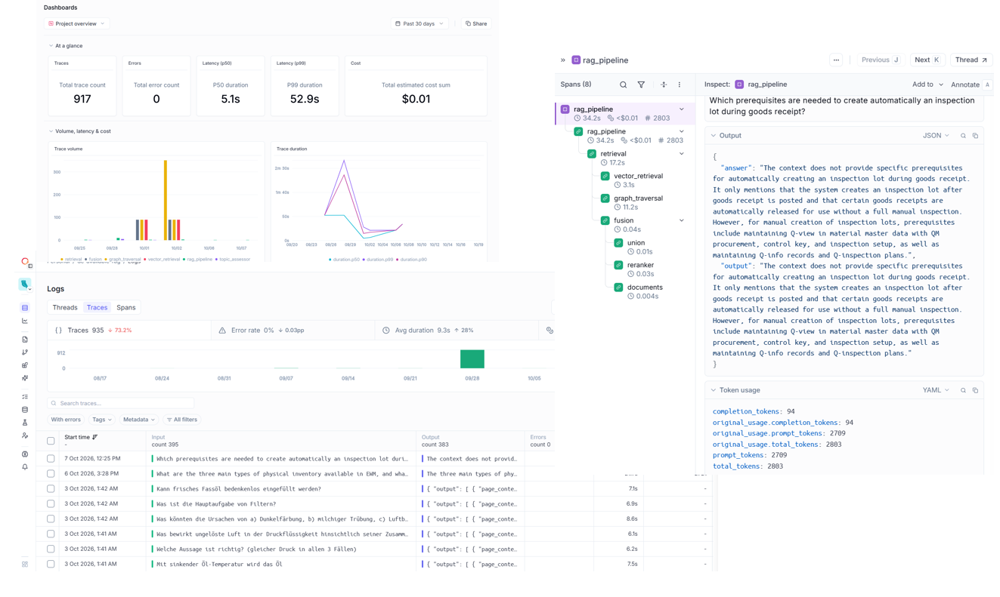

# Observability with Opik

Opik records request behavior so operators can inspect retrieval, generation,
latency, and model usage. It is a separate service, not the knowledge store.

For installation, corporate-network workarounds, start/stop commands, and storage
considerations, see [Opik Setup](opik-setup.md). The vector-store service has its
own [Qdrant Setup](qdrant-setup.md) guide.



*Example dashboard, not a statement of current production health.
[Open full size](../assets/figures/observability/dashboard.png).*

!!! warning "Review before sharing"
	The screenshot contains example training questions and generated answer text.
	Obtain content-owner approval or supply a redacted replacement before
	distributing the documentation outside its authorized audience.

## What to Inspect

| Concept | Meaning |
| --- | --- |
| Span | One recorded processing step, such as vector or graph retrieval. |
| Trace | One request or agent stage, containing nested steps. |
| Thread | Related activity within a conversation or session. |
| Feedback score | An evaluation result attached to a trace, when scoring ran. |

For a slow or incorrect answer, find its trace from the Q&A **Logs** area. Check
the selected retrieval mode, returned passages, model output, and duration by
stage. Estimated costs and recorded token counts depend on available metadata;
they are not a billing statement.

## Local Configuration

The Opik server is not bundled in this repository. Run an approved self-hosted
release using its upstream deployment instructions, then point AVAILABLE at it:

```powershell
$env:OPIK_URL_OVERRIDE = "http://localhost:5173/api"
$env:OPIK_UI_URL = "http://localhost:5173"
$env:OPIK_PROJECT_NAME = "dc-available-rag"
$env:OPIK_WORKSPACE = "default"
```

Restart the app after changing settings. Send a test question and verify that a
trace appears in the intended project. In containers, `localhost` refers to that
container, not the host or another service; configure reachable service URLs.

The legacy local setup notes describe organization-specific frontend image
workarounds. They are not a portable installation recipe for all Opik releases.
Pin and review a server release rather than applying line-number edits to an
unreviewed upstream checkout.

## Optional LLM Judge

The Q&A judge is **off by default**. Set `AVAILABLE_ENABLE_JUDGE=1` before
starting the app to enable the extra evaluation call. The current judge uses
`gpt-4o-mini`, so that deployment and identity permissions must also be available.
Its feedback covers hallucination, answer relevance, and context precision.
Absence of those scores can mean the judge was disabled or failed; it is not a
quality result. Model-generated judgments are not ground-truth labels.

## Privacy and Availability

Traces can contain questions, retrieved passages, answers, and identifying
metadata. Confirm access control, approved storage, and retention before enabling
telemetry for restricted material. Screenshots used in reports also need review.

Opik is not required as a knowledge source, but instrumentation exists in the
application and some paths explicitly enable tracking. Do not assume one global
disable setting suppresses all telemetry. Validate behavior in your environment
and investigate connection errors separately from Qdrant or Azure model failures.