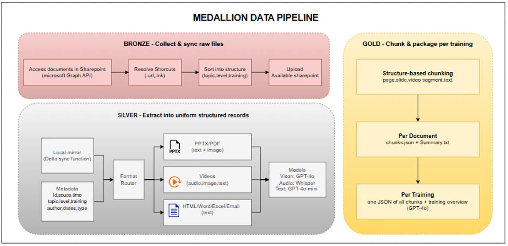

# Pipeline Operations

The pipeline prepares the knowledge base independently of the Streamlit app.
Run commands from `dc-available` with the intended source and collection settings.



*Data preparation flow. [Open the full-size diagram](../assets/figures/pipeline/etl-pipeline.png).*

## Stage Responsibilities

| Stage | Reads | Produces |
| --- | --- | --- |
| Ingest | Unorganized source material | Classified content published to the organized SharePoint library. |
| Sync | Organized SharePoint library | Local raw mirror and synchronization state. |
| Preprocess | Raw training folders | Per-training chunks, summaries, extracted media, and handbook. |
| Index | Ingestion artifacts | Qdrant chunk collection, parent-document store, structural/semantic graph, and entity collection. |
| Trust score | Documents, metadata, and graph | Query-independent reliability signals for source ranking. |
| Serve | Prepared artifacts and Qdrant | Interactive assistant or Q&A application. |

Ingest is a separate publishing workflow, not part of the automatic sync-to-index
orchestrator. See [SharePoint integration](sharepoint.md).

## Choose the Right Workflow

### Build from Local Files

This route does not synchronize with SharePoint:

```powershell
$env:AVAILABLE_APP_SOURCE = "available"
poetry run python -m pipeline.preprocess --source available
poetry run python -m pipeline.index --source available
```

The current trust builder requires GROWNFIELD SharePoint metadata; it is not a
generic local-file stage. For that configured corpus, run the metadata,
alignment, prior, and final trust commands in the [trust guide](../architecture/trust.md).

### Refresh from SharePoint

After configuring and validating sync access:

```powershell
poetry run python -m pipeline.run_pipeline --source available
```

The orchestrator runs sync first. If no remote additions or deletions are
reported, it stops without preprocessing, indexing, or trust scoring. Known
remote files are not redownloaded, even when their version tags change; those
updates are metadata-only and do not trigger rebuilding. When additions or
deletions are detected, it preprocesses, performs a **full index refresh**, and
then recomputes trust. This can involve substantial model calls and collection
replacement; it is not incremental vector indexing.

!!! warning "Protect active data"
    Test refreshes against isolated data and collections. Capture a coordinated
    backup before replacing shared indexes, and avoid overlapping index jobs.

## Preprocessing Controls

| Option | Use |
| --- | --- |
| `--training <path>` | Limit processing to a training folder. |
| `--overwrite` | Reprocess trainings rather than accepting cached results. |
| `--verbose` | Include extraction and model logs. |
| `--cleanup-downloads` | Remove mirrored raw files after successful processing. |

Supported material includes PDF, Office presentations/documents/spreadsheets,
MP4, MSG email, and HTML. Format-specific tools and model access may be required.
Preprocessing keeps derived media outside the raw mirror and caches training
outputs to avoid unnecessary model calls.

!!! warning "Cleanup removes local raw material"
    Do not use `--cleanup-downloads` on your only copy of a corpus. Keep an
    authoritative source and understand the subsequent sync behavior first.

## Indexing Controls

With no phase selectors, `pipeline.index` runs all index phases. Selectors limit
the work; they do not automatically supply missing outputs from earlier phases.

```powershell
poetry run python -m pipeline.index --source available --vectordb
poetry run python -m pipeline.index --source available --graph
poetry run python -m pipeline.index --source available --semantic
```

| Option | Effect |
| --- | --- |
| `--refresh` | Force a clean rebuild; can recreate collections and replace artifacts. |
| `--vectordb` | Build chunk vectors and parent-document assets. |
| `--graph` | Build structural graph and semantic extraction batches. |
| `--semantic` | Extract, merge, and integrate entities; build the entity index. Requires graph outputs first. |
| `--semantic-topics <keys>` | Restrict semantic extraction to comma-separated topic keys. |
| `--semantic-max-batches-per-topic <count>` | Limit semantic extraction for test runs; `0` means all batches. |
| `--semantic-model <name>` | Select the extraction model; default `gpt-4o`. |

After changing the graph or source corpus, recompute trust. Do not combine a new
vector collection with stale parent-document or graph artifacts.

## Completion Checks

1. Review stage logs for errors and skipped inputs, not just process completion.
2. Confirm per-training ingestion outputs and the parent-document store exist.
3. Inspect the intended chunk and entity collections in Qdrant.
4. Confirm graph and trust outputs correspond to the same corpus build.
5. Start Q&A and test a known question with a verifiable citation.

Record the source version, collection names, model choices, command options,
start/end times, and failures for repeatable operations. A successful serve
startup alone does not validate graph coverage or answer quality.