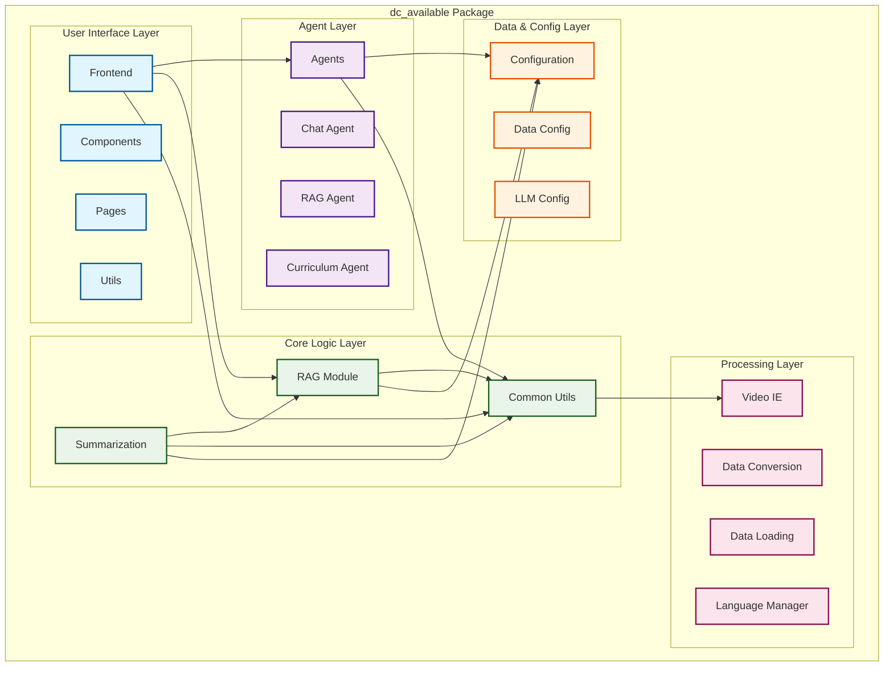
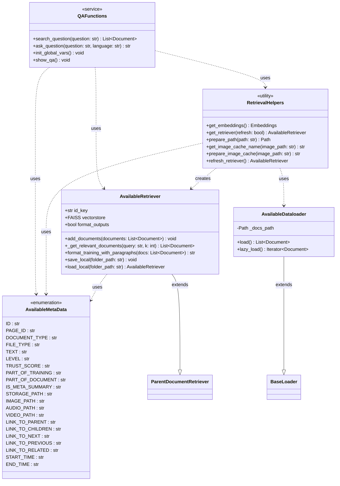
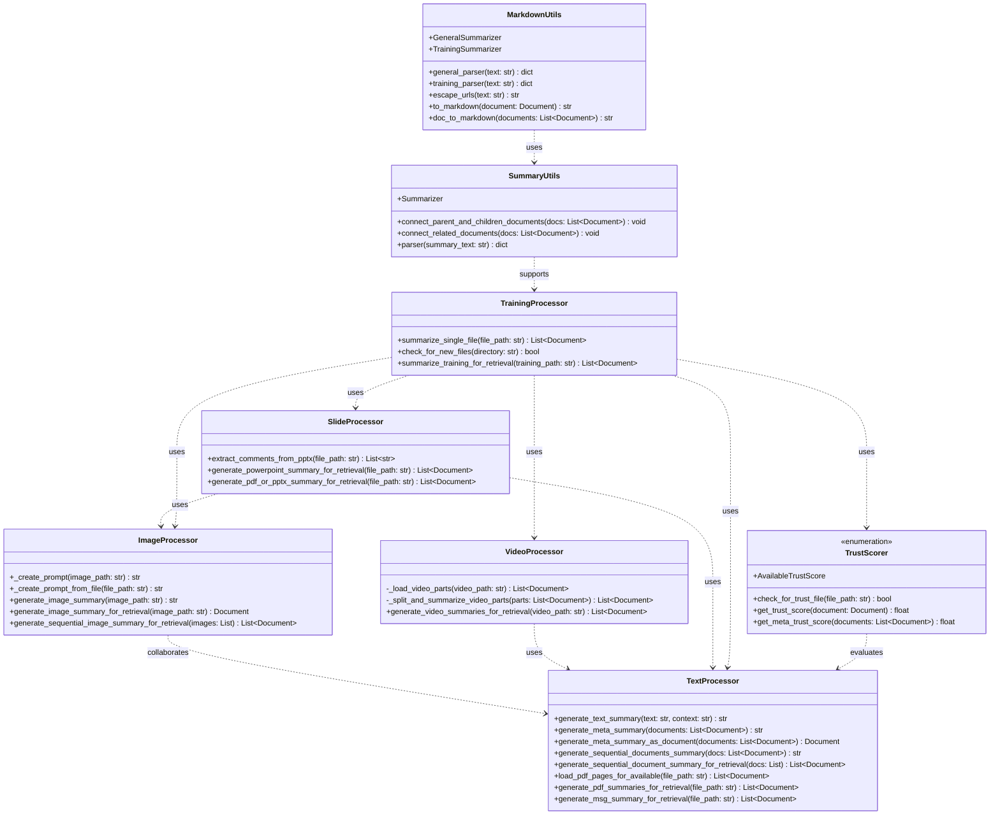
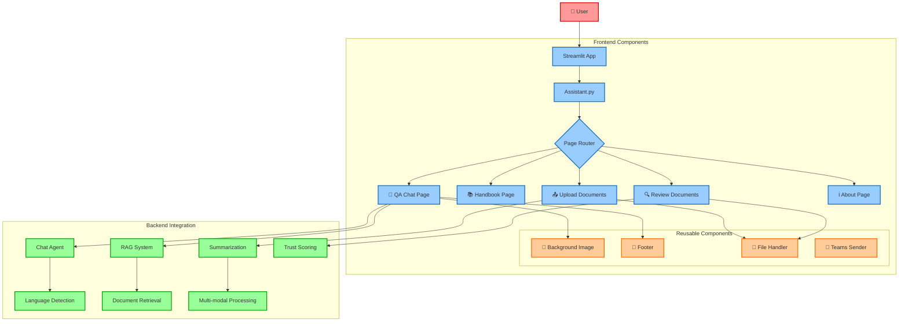
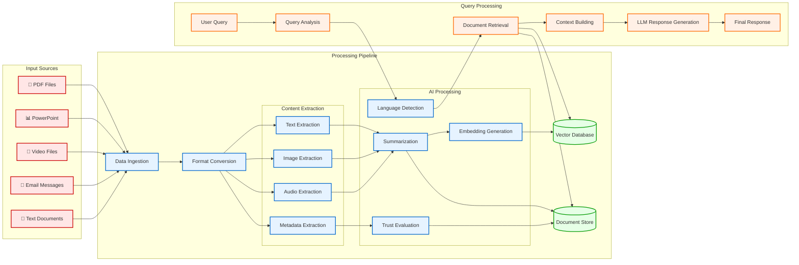

# AVAILABLE Chatbot

This project implements an intelligent chatbot application designed to provide information from various document types using Retrieval-Augmented Generation (RAG) and advanced summarization techniques. The application features a Streamlit-based frontend, multi-modal content processing (PDFs, PowerPoints, videos, emails), and language detection capabilities.

## Features

*   **Multi-modal Content Processing:** Ingests and processes information from diverse sources including PDF documents, PowerPoint presentations, video files (MP4), and email messages (MSG).
*   **Retrieval-Augmented Generation (RAG):** Utilizes a RAG system to retrieve relevant information from processed documents and generate accurate, context-aware responses to user queries.
*   **Advanced Summarization:** Employs various summarization techniques for different content types (text, images, videos) to extract key information and create concise overviews.
*   **Streamlit Frontend:** Provides an interactive and user-friendly web interface for chatbot interaction, document uploading, and review.
*   **AI Agents:** Incorporates AI agents for managing conversational flow, assessing user intent, and orchestrating information retrieval.
*   **Language Detection and Management:** Automatically detects the user's language and adapts responses accordingly.
*   **Document Trust Scoring:** Implements a system to assess and display the trustworthiness of documents.

## Project Structure

The project is organized into several key directories, each responsible for a specific part of the application:

*   `dc_available/`: The main application package containing core logic.
    *   `agents/`: Contains AI agents for handling different tasks like chat and RAG.
    *   `common/`: Provides common utility functions, data loading, data conversion, and language management.
    *   `config/`: Stores configuration settings for data paths, LLMs, and other application parameters.
    *   `frontend/`: Implements the Streamlit user interface, including pages and reusable components.
    *   `RAG/`: Contains the core Retrieval-Augmented Generation (RAG) logic, including data models, QA functions, and retrieval mechanisms.
    *   `summarization/`: Handles the summarization of various content types (images, texts, videos, slides) and trust scoring.
*   `deployment/`: Contains files related to deployment, such as Dockerfiles and Taskfiles.
*   `expriment/`: Contains experimental code or prototypes.
*   `resources/`: Stores static resources, including the available handbook and processed data.

## UML Documentation

### System Architecture Overview

The following diagram illustrates the high-level architecture of the project, showing the main packages and their dependencies.



### RAG Module Architecture

This diagram details the classes within the `RAG` module, illustrating their responsibilities and interconnections.



### Summarization Module Architecture

This diagram shows the comprehensive summarization pipeline with different content processors.



### Frontend Architecture Flow

This diagram shows the user interaction flow and component relationships in the frontend.



### Data Flow Architecture

This diagram illustrates how data flows through the system from input to output.



## Setup and Installation

To set up this project, you will typically need to:

1.  **Clone the repository:** `git clone <repository_url>`
2.  **Install dependencies:** This project uses Python. Install dependencies using `pip` or `poetry`:
    ```bash
    pip install -r requirements.txt
    # or
    poetry install
    ```
3.  **Configure environment variables:** Set up necessary environment variables for:
    - API keys (OpenAI/Azure OpenAI)
    - Data paths and storage locations
    - Configuration settings as specified in `config/llm_config.py` and `config/data_config.py`
4.  **Prepare data directories:** Ensure your data structure follows the expected format:
    ```
    resources/
    ├── available_handbook/
    ├── processed_data/
    └── uploads/
    ```
5.  **Run initial setup:** Execute any data processing or indexing scripts to prepare the vector database.

## Usage

### Starting the Application

1.  **Launch the Streamlit app:**
    ```bash
    streamlit run dc_available/frontend/Assistant.py
    ```

2.  **Access the web interface:** Open your browser to `http://localhost:8501`

### Key Features Usage

- **💬 Chat Interface:** Ask questions in natural language and receive context-aware responses
- **📤 Document Upload:** Upload PDFs, PowerPoint files, videos, or emails for processing
- **🔍 Document Review:** Review processed documents and their trust scores
- **📚 Handbook Access:** Browse the integrated knowledge base
- **🌐 Multi-language Support:** The system automatically detects and responds in your preferred language

### Supported File Types

| File Type | Extension | Processing Features |
|-----------|-----------|-------------------|
| PDF Documents | `.pdf` | Text extraction, image analysis, page-by-page processing |
| PowerPoint | `.pptx`, `.ppt` | Slide content, speaker notes, embedded images |
| Videos | `.mp4` | Speech-to-text, image frame analysis, temporal segmentation |
| Emails | `.msg` | Content extraction, attachment processing, metadata analysis |
| Text Files | `.txt`, `.md` | Direct text processing, formatting preservation |

This enhanced README provides a comprehensive overview of the project with improved UML documentation that better visualizes the system architecture, component relationships, and data flow patterns.